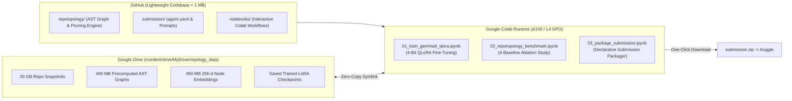

# 🪐 RepoTopology: Agentic Codebase Comprehension & 3-Tier AST Context Pruning

[](https://github.com/catlikeflyer/repotopology/actions/workflows/ci.yml)
[](https://colab.research.google.com/github/catlikeflyer/repotopology/blob/main/notebooks/01_train_gemma4_qlora.ipynb)
[](https://colab.research.google.com/github/catlikeflyer/repotopology/blob/main/notebooks/02_repotopology_benchmark.ipynb)
[](https://colab.research.google.com/github/catlikeflyer/repotopology/blob/main/notebooks/03_package_submission.ipynb)

**RepoTopology** is an agentic code intelligence framework for **Gemma 4 (E4B / 31B)** submitted to the **Google - The Gemma 4 Developer Agent Competition**. It combines directed AST multigraph exploration with a 3-tiered dynamic context-pruning engine exposed via a local FastMCP server.

---

## ⚡ Colab-First Architecture: Zero Local Storage Bloat

The SWE-bench / Gemma competition dataset contains **20+ GB of repository snapshots, embeddings, and AST graphs**. Running or storing this locally clogs disk space and exceeds GitHub's repository limits. 

RepoTopology is architected to run **100% cloud-hosted in Google Colab**:
- **Lightweight GitHub Repo (< 1 MB)**: Tracks only core code, declarative configs, prompts, and notebooks.
- **Google Drive Data Backbone**: Heavy datasets (`snapshots/`, `graphs/`, `embeddings/`) are stored in Google Drive and symlinked in Colab in 1 second without copying gigabytes to disk.
- **Hardware-Accelerated Training & Evaluation**: Run 4-bit QLoRA fine-tuning and batch evaluations directly on Colab GPUs (A100, L4, or T4).



---

## 📓 Interactive Google Colab Notebooks

Execute end-to-end workflows in your browser with zero local installation:

| Notebook | Focus | Recommended Runtime | Link |
| :--- | :--- | :--- | :--- |
| **01. Train Gemma 4 QLoRA** | 4-bit NF4 QLoRA fine-tuning for Gemma 4 31B or E4B on AST trajectories. Auto-saves weights to Google Drive. | A100 GPU (High-RAM) | [](https://colab.research.google.com/github/USERNAME/repology/blob/main/notebooks/01_train_gemma4_qlora.ipynb) |
| **02. Run Benchmark** | 4-baseline comparative ablation study (Grep vs. Vector RAG vs. Unpruned vs. RepoTopology). | T4, L4, or CPU | [](https://colab.research.google.com/github/USERNAME/repology/blob/main/notebooks/02_repotopology_benchmark.ipynb) |
| **03. Package Submission** | Validates `adk-submission` schema, attaches trained LoRA, and exports `submission.zip`. | Standard CPU | [](https://colab.research.google.com/github/USERNAME/repology/blob/main/notebooks/03_package_submission.ipynb) |

---

## 🧹 Freeing Up Local Storage (Reclaim 20+ GB)

If you previously downloaded the heavy competition datasets or repository snapshots locally, run the included storage reclamation script:

```bash
./scripts/free_local_storage.sh
```

This will safely remove:
- `data/snapshots/` (~20 GB)
- `data/embeddings/` & `data/graphs/` (~850 MB)
- Local caches & virtual environments if selected

The script preserves your source code, configuration files, prompts, and synthetic test suites.

---

## 🏛️ RepoTopology Engine Core

1. **`repotopology.graph_store.GraphStore`**:
   - Directed multigraph representation (`nx.MultiDiGraph`) over repository ASTs.
   - Cosine similarity entrypoint search using 256-dimensional float32 vector embeddings.
   - Directed edge traversal for callers, callees, definitions, and imports.

2. **`repotopology.pruner.ContextPruner`**:
   - **Tier 1 (Focus Symbol)**: Full raw source implementation.
   - **Tier 2 (1-Hop Neighbors)**: AST-extracted signatures, decorators, type hints, and docstrings (bodies replaced with `...`).
   - **Tier 3 (2-Hop Neighbors)**: Qualified symbol identifiers only.

3. **`repotopology.server` (FastMCP)**:
   - Exposes `search_similar_code`, `get_code_neighbors`, and `get_pruned_context` over standard input/output.

4. **`repotopology.evaluator.BenchmarkEvaluator`**:
   - Automated ablation harness comparing:
     - **Baseline 0**: Grep / Raw File Reading
     - **Baseline 1**: Dense Vector RAG Alone
     - **Baseline 2**: Unpruned Graph Agent
     - **Baseline 3**: RepoTopology (3-Tier Pruning)

---

## 🛠️ Local Development & Quick Tests

All tests run in **< 1 second** without requiring the 20 GB snapshot dataset:

```bash
# 1. Install dependencies
pip install -e ".[dev]"

# 2. Run unit & pipeline tests (9 tests in ~0.5s)
pytest -v

# 3. Run evaluator on synthetic sample dataset
repotopology-eval --generate-sample-if-missing
```

---

## 📂 Repository Structure

```
repology/
├── .github/workflows/ci.yml       # Automated GitHub Actions test suite
├── .gitignore                     # Strict exclusion of 20GB datasets & caches
├── README.md                      # Documentation & Colab Hub
├── pyproject.toml                 # Package definition with [colab] and [dev] extras
├── colab_train_gemma4_31b.ipynb   # Standalone Colab training notebook
├── notebooks/                     # Colab-native interactive notebooks
│   ├── 01_train_gemma4_qlora.ipynb
│   ├── 02_repotopology_benchmark.ipynb
│   └── 03_package_submission.ipynb
├── repotopology/                  # Core Python library
│   ├── agent.py                   # ReAct agent loop
│   ├── colab_utils.py             # Google Drive & hardware detection helpers
│   ├── evaluator.py               # 4-baseline ablation runner
│   ├── graph_store.py             # AST graph & vector search
│   ├── package_submission.py      # Declarative bundle builder
│   ├── pruner.py                  # 3-tier AST context pruner
│   ├── server.py                  # FastMCP server
│   ├── trajectory_generator.py    # SFT data generator
│   ├── train_lora.py              # HF TRL QLoRA training script
│   └── train_mlx.py               # Apple Silicon MLX training script
├── scripts/
│   ├── colab_setup.sh             # One-step Colab environment installer
│   └── free_local_storage.sh      # Reclaims 20+ GB local disk space
├── submission/                    # Declarative competition submission
│   ├── agent.yaml                 # ADK runner configuration
│   ├── eval_config.yaml           # Token & step budgets
│   ├── configs/sampling.yaml      # Model sampling parameters
│   ├── prompts/                   # System & analyzer prompts
│   └── sub_agents/                # Declarative sub-agents
└── tests/                         # Fast isolated unit tests
    └── test_pipeline.py
```

---

## 📜 Competition Submission Checklist

1. Run `notebooks/01_train_gemma4_qlora.ipynb` on Colab A100 to fine-tune your adapter.
2. Run `notebooks/02_repotopology_benchmark.ipynb` to verify token efficiency and hit rate.
3. Run `notebooks/03_package_submission.ipynb` to download `submission.zip`.
4. Upload `submission.zip` to Kaggle under **Google - The Gemma 4 Developer Agent Competition**.
